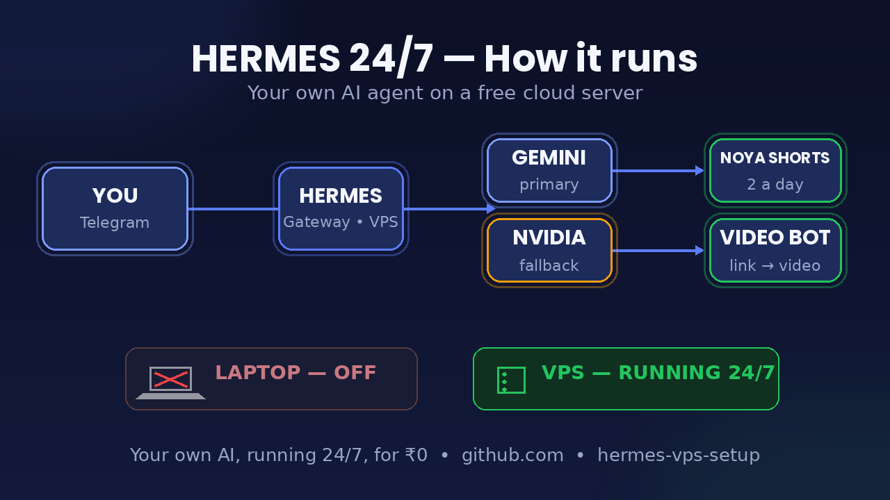

# Run Hermes 24/7 — Your Own AI Agent on a Free VPS


**Your own AI assistant, running 24/7, for ₹0.** [Hermes Agent](https://github.com/hermes-agent) on an Oracle Cloud Always Free VPS — talk to it from Telegram, from anywhere, even when your laptop is off, asleep, or its Wi-Fi drops.

## The problem

Hermes lived on my laptop. Laptop sleeps → agent dies. Laptop reboots → gateway dies. Home Wi-Fi drops → Telegram dies. An AI assistant that only works when my laptop is awake isn't an assistant — it's a screensaver.

So I moved it to a free cloud VM. Now Hermes and my Telegram video-downloader bot both run 24/7 on one Oracle Always Free instance, and the laptop is only needed for things that need a screen or a Google sign-in.

## Architecture



[▶ Watch the 60fps demo video (1080p, 31s)](hermes-24-7-demo-1080p.mp4)

```mermaid
flowchart LR
    U[You — Telegram] -->|/start, tasks| B[@noyastick_bot]
    B --> G[Hermes Gateway\nsystemd, VPS]
    G --> H[Hermes Agent v0.23.4\nUbuntu 24.04 aarch64]
    H -->|primary| GM[Gemini\ngemini-3.1-flash-lite]
    H -->|fallback| NV[NVIDIA NIM\nnemotron-3.5-super-vl]
    H --> S[Skill: noya-owns-workflow]
    S --> N[Noya Owns Shorts\n2/day, 8 PM + 10 PM IST]
    H --> V[Video bot\n@videoo_waleagyebot]
    V --> Y[yt-dlp downloads]
```

| Component | Where | Notes |
|---|---|---|
| Hermes Agent v0.23.4 | Oracle VPS (A1 Flex, 1 OCPU / 6 GB) | aarch64 build, systemd gateway |
| Telegram gateway | Same VPS | `@noyastick_bot`, allowlist = your Telegram ID only |
| Model (primary) | Gemini `gemini-3.1-flash-lite` | Direct — the VPS has no OmniRoute |
| Model (fallback) | NVIDIA NIM `nvidia/nemotron-3.5-super-vl-120b-a12b` | Reasoning effort `high` (never `medium` — NVIDIA rejects it with 400) |
| Workflow skill | `noya-owns-workflow` | Noya Owns Shorts — dialogue-only, script-first, no captions |
| Video bot | Same VPS (`/opt/videobot`) | Public mode, `@videoo_waleagyebot` — see [telegram-video-downloader-bot](https://github.com/realdarkbytex-hub/telegram-video-downloader-bot) |
| Laptop | Only when needed | Google sign-in, Gemini clip generation, screen work |

## What Hermes does on the VPS

- **Noya Owns workflow** — 2 family-betrayal drama Shorts a day, scheduled 8 PM + 10 PM IST. Dialogue-only (no narrator), script shown first and explained in Hinglish, same-character consistency, duplicate-check, verified Studio report. See `WORKFLOW.md`.
- **Control + files + light tasks** — the VPS has no GPU, so Hermes does coordination, not heavy rendering. Heavy script/code goes to a Pro/Claude model in Antigravity.
- **What Hermes CANNOT do** — sign in to Gemini/Claude, or generate Gemini clips. That's the user's own Google sign-in on the laptop. Hermes works from a pasted Claude script.

## Cost — ₹0/month

| Item | Cost |
|---|---|
| Oracle A1 Flex 1 OCPU / 6 GB, 200 GB | ₹0 (Always Free, no expiry) |
| Gemini free tier | ₹0 |
| NVIDIA NIM free tier | ₹0 |
| **Total** | **₹0** |

No paid shape, ever. If Oracle offers you a paid upgrade, say no.

## Repo contents

| File | What it is |
|---|---|
| `SETUP.md` | Full setup, start to finish: OCI API key, VM launch, Hermes install, Telegram gateway, model config |
| `ARCHITECTURE.md` | How the pieces fit, the model routing, and the failure modes |
| `WORKFLOW.md` | The Noya Owns workflow Hermes follows on the VPS |
| `OCI-API-KEY-SETUP.md` | OCI CLI + API key setup (no 2FA code needed after this) |

## Quick start

1. Read `SETUP.md` — OCI API key, VM launch (with capacity retries), Hermes install.
2. Copy `WORKFLOW.md` to Hermes as a skill (`noya-owns-workflow`).
3. Configure the Telegram gateway with your bot token (never paste tokens in chat) and allowlist only your own Telegram ID.
4. Test: send `/start` to your bot, then `hi` — Hermes should reply from the VPS. Then turn the laptop OFF and send another message. It should still reply. That's the whole point.

## Hard lessons (read before you start)

1. **Oracle MFA can't be turned off (25D+).** Browser VM retries will keep dying at the authenticator code. Use an OCI API key — CLI requests never ask for 2FA.
2. **Always Free Ampere capacity is scarce.** The VM launch failed 4 times with "Out of host capacity" before a 15-minute CLI retry loop finally got one. Don't terminate a running VM — you may not get one back.
3. **Launch the VM WITH an SSH key.** Oracle has no way to add an SSH key to a launched instance, no `user_data` on a launched instance, and the Run Command agent (`ocarun`) has no sudo and can't write to `/home/ubuntu`. If you launch without a key, recovery means a GRUB `init=/bin/bash` edit over VNC + serial console. See `SETUP.md` Part 5.
4. **GRUB is graphical-only on this image.** It never prints to the serial console. Use the VNC console (SSH tunnel, port 5900), hold Esc from the moment the screen goes black.
5. **One Telegram bot token = one poller.** Don't run the laptop gateway and the VPS gateway at the same time — you'll get a polling conflict and each update goes to only one of them. Stop the laptop gateway before starting the VPS one.
6. **VM has no OmniRoute.** The laptop Hermes used OmniRoute (`localhost:20128`); the VPS uses direct Gemini + NVIDIA fallback instead. Don't copy the laptop model config verbatim.
7. **A token can get corrupted when a script edits `.env`.** If the bot suddenly 401s after an `.env` change, check the token first — don't debug the network. (This happened to us: the bot 401-looped right after a PUBLIC_MODE edit.)

## Troubleshooting

| Symptom | Likely cause | Fix |
|---|---|---|
| Bot replies on one Telegram ID, silent on another | Old private build still polling (laptop bot) | Stop the laptop bot; only the VM bot should poll |
| `HTTP Error 401: Unauthorized` loop | BOT_TOKEN invalid / corrupted in `.env` | Put the correct token back (from BotFather), restart the service |
| Polling conflict on the gateway | Laptop + VPS gateways both running | Stop the laptop gateway, restart the VPS gateway |
| `Out of host capacity` on launch | Always Free Ampere scarce | 15-min CLI retry loop on AD-1; don't terminate a running VM |
| `oci` prompts for a passphrase | Key was created with an empty passphrase (encrypted) | Recreate the keypair answering `N/A` at the passphrase prompt |
| Serial console rejects your key | Console connections need RSA | Generate an RSA keypair — ed25519 is rejected |

## Security

- Never paste API keys, bot tokens, or private keys in chat/Telegram. Keys live in `~/.hermes/.env` and `/opt/videobot/.env` (chmod 600).
- Telegram gateway allowlist: your Telegram ID only. Never leave it empty — that's open access.
- Never share your Google password with an agent. You sign in yourself.
- No real IPs, OCIDs, tokens, or keys in this repo — only placeholders.
